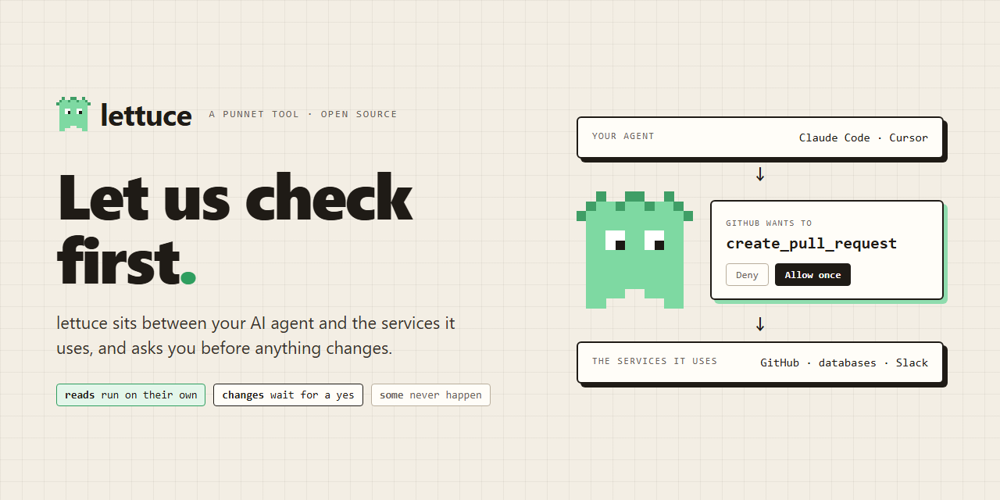
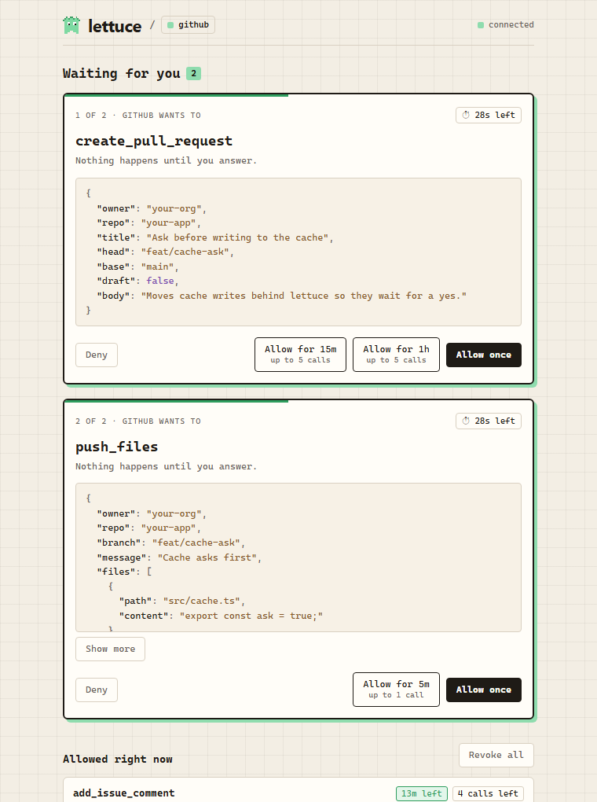
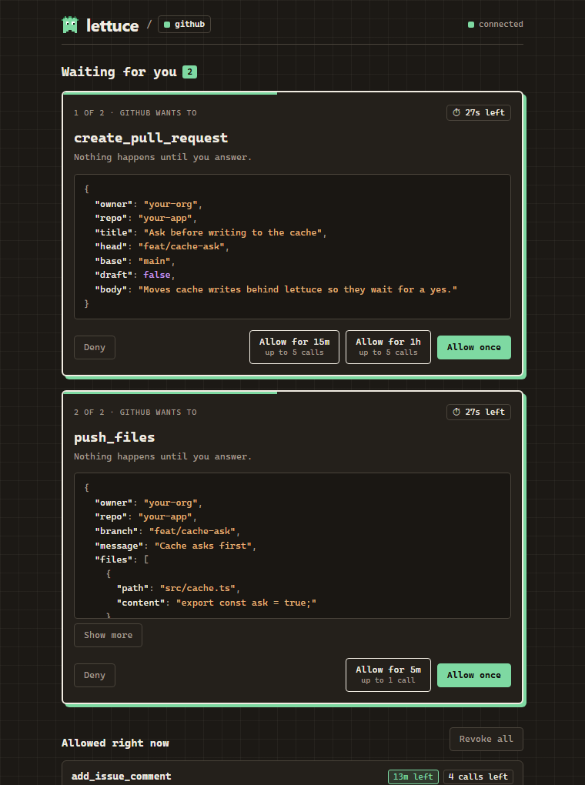

<p align="center"></p>

<p align="center">
  <a href="https://www.npmjs.com/package/lettuce-mcp"></a>
  <a href="https://github.com/Primitivelabai/lettuce/actions/workflows/ci.yml"></a>
  <a href="LICENSE"></a>
  
</p>

<p align="center"><a href="https://glama.ai/mcp/servers/Primitivelabai/lettuce"></a></p>

# lettuce

Your agent just tried to `push_files` to main. Did you mean to let it?

**Let us check first.** lettuce sits between your AI agent and its MCP servers (GitHub, Postgres, Slack, your files). Reading runs. Changes wait for you. Some things never happen.

- **Ask.** A change pauses and opens a small page in your browser. Allow it once, or for a while (say 15 minutes, up to 5 calls).
- **Never.** Tools you mark `never` are hidden from the agent and blocked if it calls them anyway.
- **Receipts.** Each tool call lettuce checks, and each request it refuses, is written to `~/.lettuce/receipts.jsonl`. Every entry holds the hash of the one before, so an edited entry, or one removed from the middle, shows up. If a receipt can't be written, the call is denied anyway.
- **Saved tokens.** Tokens can come from your system's secret storage instead of sitting in plain text in `.mcp.json`.

Works with Claude Code, Cursor, Gemini CLI and anything else that runs MCP servers over stdio.

## Try it

```bash
npx lettuce-mcp demo
```

Your browser opens with a pretend pull request waiting for you.

## What you see

When the agent wants to change something, a small page opens in your browser. Nothing happens until you answer.

<p align="center">
  
  
</p>

## Wrap a server

Put `lettuce-mcp wrap` in front of the server's command in `.mcp.json`, `claude_desktop_config.json` or your Cursor MCP settings:

```json
{
  "mcpServers": {
    "github": {
      "command": "npx",
      "args": [
        "-y",
        "lettuce-mcp",
        "wrap",
        "--name",
        "github",
        "--",
        "npx",
        "-y",
        "@modelcontextprotocol/server-github"
      ]
    }
  }
}
```

Then make a `lettuce.yaml` next to it (`npx lettuce-mcp init`):

```yaml
version: 1
default_action: ask
approval_timeout_ms: 60000

secrets:
  GITHUB_PERSONAL_ACCESS_TOKEN: 'keychain://lettuce/github-token'

rules:
  - tools: ['get_*', 'list_*', 'search_*']
    action: allow

  - tools: ['create_pull_request', 'push_files']
    action: ask
    lease_options: ['once', '15m', '1h']
    max_calls_per_lease: 5
    constraints:
      owner: { equals: 'your-org' }

  - tools: ['delete_repository', 'merge_pull_request']
    action: never
```

`never` beats `ask`, and `ask` beats `allow`. A tool no rule matches gets `default_action`. A rule with `constraints` only matches calls whose arguments fit, so the example above asks for pull requests on `your-org` and falls back to `default_action` for everything else. Keep `default_action: ask` unless you mean it. A `never` rule with `constraints` blocks the matching calls but leaves the tool visible, since other calls to it may be fine.

lettuce says no when it isn't sure:

- If nobody answers in time, the call is denied.
- If you edit `lettuce.yaml` and it stops loading, every call is denied until it loads again.
- If the policy changes while a request waits, lettuce checks again before running it.
- With `default_action: never`, tools no rule allows or asks about are hidden too.
- lettuce gates tools. Other standard MCP requests (resources, prompts, completions) pass through, and anything it doesn't recognise is refused.

## Commands

```bash
lettuce init             # make a starter lettuce.yaml here
lettuce demo             # try an approval in your browser
lettuce secret set NAME  # save a token in your system's secret storage
lettuce receipts --tail  # watch decisions as they happen
lettuce verify           # check the receipts haven't been edited
lettuce verify --since H # also check every entry up to hash H is still there
lettuce revoke           # end every active approval now
```

Run them with `npx lettuce-mcp <command>`, or install it with `npm i -g lettuce-mcp` and use `lettuce`.

## What it protects against, and what it doesn't

Each wrapped server gets its own approval page on a random local port. To see or answer a request you need a key that lettuce hands only to the browser tab it opens. The key is kept in that tab's memory, so other websites, and an agent that only has MCP tools, can't approve anything.

lettuce runs as you, on your computer. The key reaches your browser through the command that opens it, so any program running as you can see it for a moment, and your browser holds it after that. An agent that can run any command as you (a shell tool with no sandbox) could find it, and could read your files too. No local tool can fully stop that. Give shell-capable agents a sandbox, and use lettuce for the MCP servers.

lettuce hides the token values it loads from `lettuce.yaml` in the wrapped server's error output, as written and as they look inside a JSON string. It can't spot a token the server prints in another form (base64, split up), or tokens it didn't load.

The receipts show an edited entry or one removed from the middle. They can't show entries removed from the end, or a whole file rewritten by someone with access to your account. `lettuce verify` prints the latest hash: save it somewhere else, and `lettuce verify --since <hash>` later proves every entry up to it is still there.

Where tokens are kept:

| System  | Where                                                                   |
| ------- | ----------------------------------------------------------------------- |
| macOS   | Keychain (`security`)                                                   |
| Linux   | Secret Service (`secret-tool`, from libsecret)                          |
| Windows | Encrypted for your Windows account with DPAPI, in `~/.lettuce/secrets/` |

## Let your agent set it up

Point your agent at [`skills/lettuce/SKILL.md`](skills/lettuce/SKILL.md) (or copy it into `.claude/skills/`) and ask it to "put lettuce in front of my MCP servers". It reads your config, wraps each server, writes a `lettuce.yaml` with you, and moves plain-text tokens into secret storage. Agents like Cline can follow [`llms-install.md`](llms-install.md).

## Develop

```bash
npm install
npm test
```

Needs Node 22 or later. Found a way past a check? See [SECURITY.md](SECURITY.md).

## From punnet

lettuce is one of the small free tools at [punnet.dev](https://punnet.dev), made by [Primitive](https://primitiveai.com.au) in Perth, Western Australia.

Want agents to sign in to websites without ever seeing your passwords? That's [Primitive Pass](https://primitivepass.com).

Apache-2.0 licence. See [LICENSE](LICENSE).
